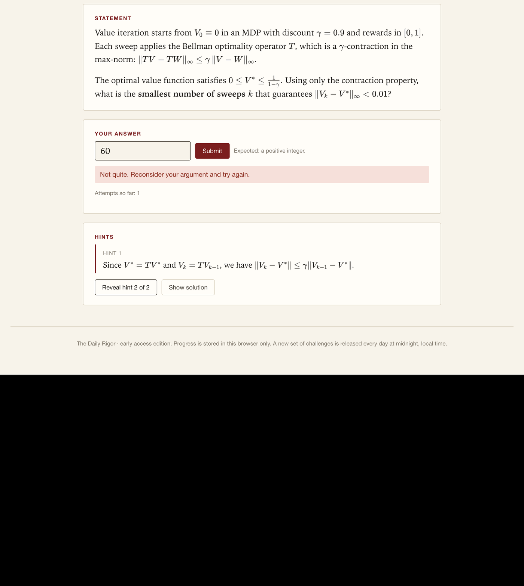
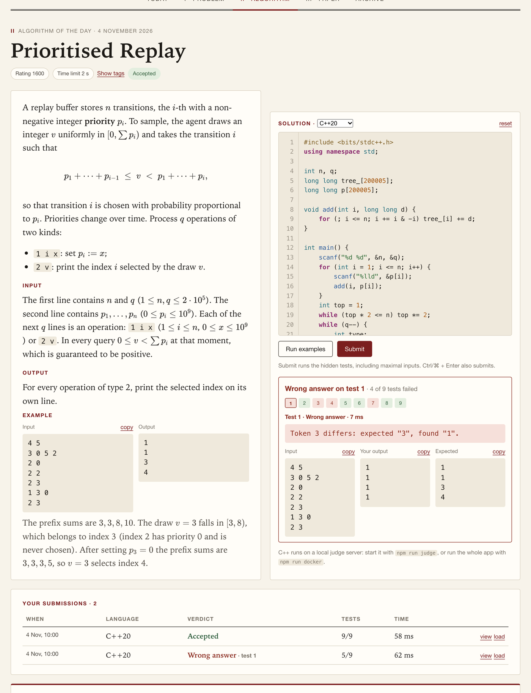
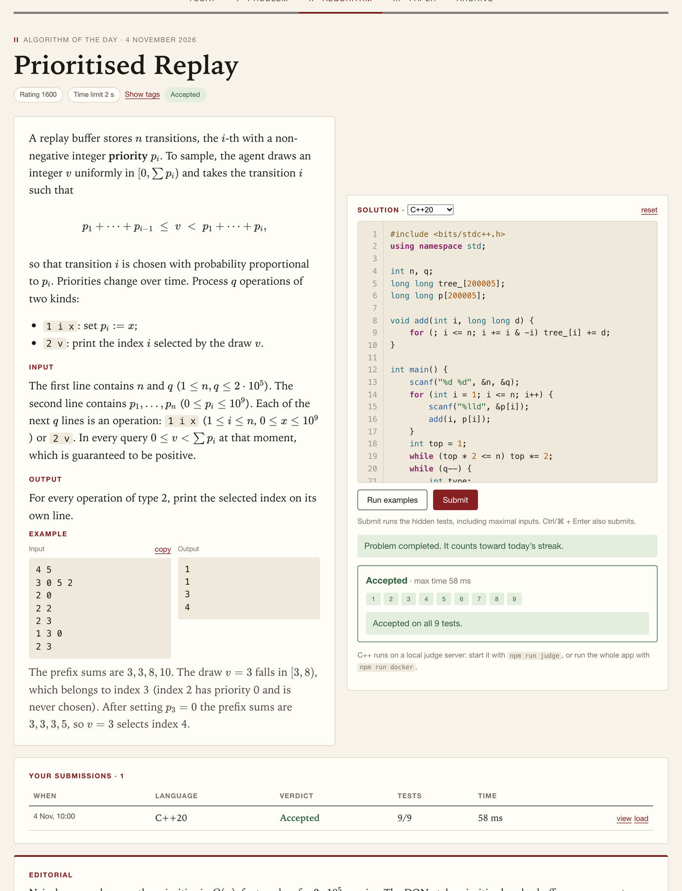
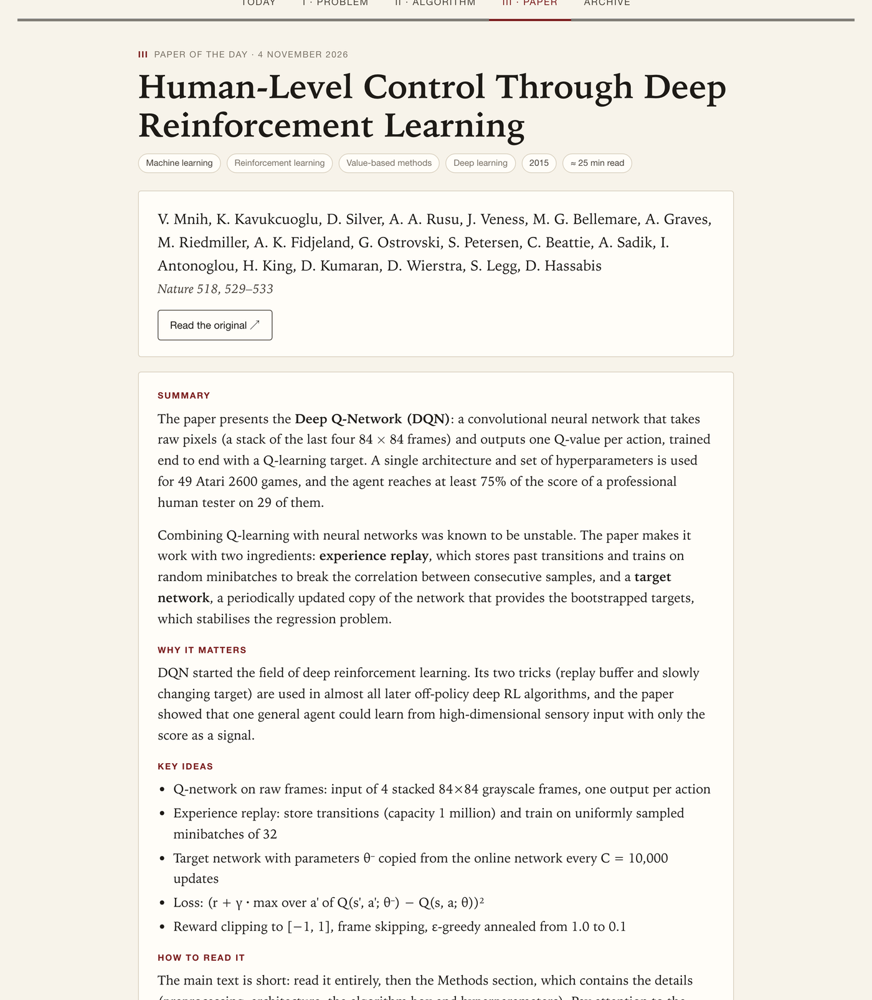
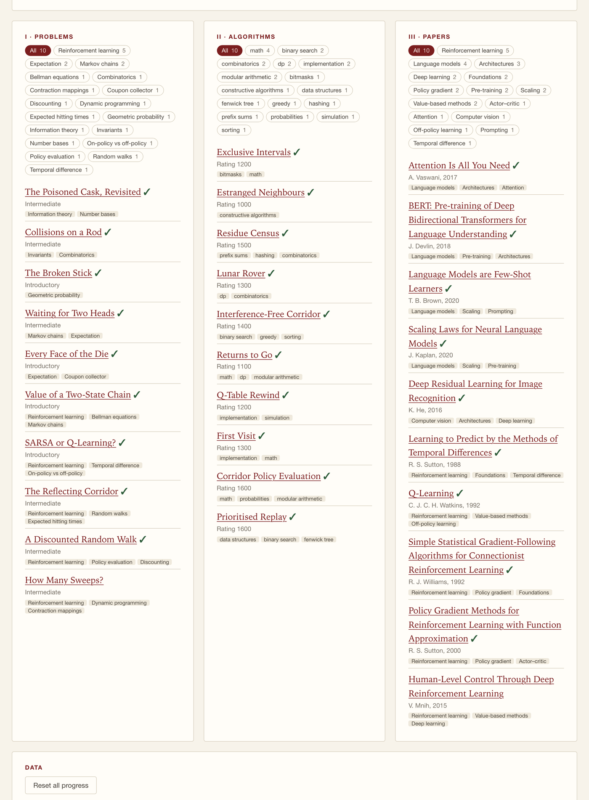
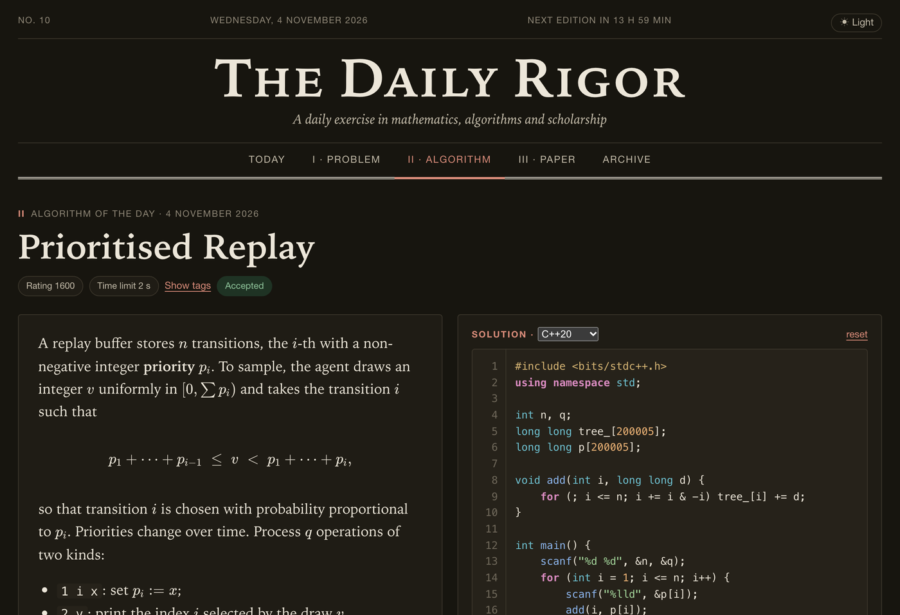

# The Daily Rigor

**A daily exercise in mathematics, algorithms and scholarship.**
Every day brings three short challenges for the scientifically minded: a puzzle that rewards insight over computation, a competitive-programming task judged against hidden tests (JavaScript or **C++20**), and a landmark paper with a comprehension quiz.


## Contents

- [The three challenges](#the-three-challenges)
- [Screenshots](#screenshots)
- [Quick start](#quick-start)
- [How the daily schedule works](#how-the-daily-schedule-works)
- [Adding content](#adding-content)
- [The C++ judge](#the-c-judge)
- [Accounts, sync and going online](#accounts-sync-and-going-online)
- [Project structure](#project-structure)
- [Testing the content](#testing-the-content)
- [Security notes and known limits](#security-notes-and-known-limits)
- [Roadmap](#roadmap)

## The three challenges

| | What you get | How it is checked |
|---|---|---|
| **I · Problem** | A tricky puzzle (probability, combinatorics, number representation, and in the reinforcement-learning weeks Bellman equations and bandits) with one verifiable answer, progressive hints and a full solution | Numeric answer with tolerance; exact fractions such as `13/27` are accepted |
| **II · Algorithm** | A Codeforces-style task: statement, examples, input/output spec, hidden tests including maximal inputs, and an editorial | Run in a Web Worker (JavaScript) or on the C++ judge, with verdicts AC / WA / TLE / RE / CE |
| **III · Paper** | A landmark but readable paper (Transformers, scaling laws, RLHF, Q-learning, PPO, …) with summary, key ideas, a reading guide and a five-question quiz | Quiz with explanations; your first submission is recorded |

The library holds **28 items per section** (28 puzzles, 28 algorithm problems, 28 papers), with category tags on every item. Papers lean towards machine learning and LLMs, but also include classics such as Turing's *Computing Machinery and Intelligence*, Diffie–Hellman, PageRank and the Bitcoin paper.

### Features

- **Streaks and progress** for each section and for "all three", stored in the browser (or in your account, see below).
- **A real code editor**: syntax highlighting for JavaScript and C++, line numbers, auto-indent, auto-closing brackets and quotes with skip-over, smart backspace, block expansion between braces, multi-line <kbd>Tab</kbd> / <kbd>Shift</kbd>+<kbd>Tab</kbd>, comment toggling with <kbd>Ctrl/⌘</kbd>+<kbd>/</kbd>, submit with <kbd>Ctrl/⌘</kbd>+<kbd>Enter</kbd>, and compiler errors highlighted on the offending line.
- **A judge report that helps you debug**: every test is run even after a failure, the failing tests are listed, and for each one you see the input, your output and the expected output (with copy buttons).
- **Submission history**: every submission, accepted or not, is saved with its code, language, verdict and time, and can be loaded back into the editor.
- **Archive** of past editions with category filters. Only challenges that have already been released are listed, so tomorrow's problem stays hidden.
- **Light and dark themes** with a toggle (follows the system until you choose).
- **Optional invitation-only sign-in** (Google or GitHub) with progress synced to the cloud.
- **KaTeX maths** in every statement, solution and quiz.

## Screenshots

### Problem of the day
Hints are revealed one at a time, and wrong answers are counted.



### Algorithm of the day
C++ solutions are compiled and judged on the server. When a submission fails, the report shows which tests failed and what your program printed.

| Wrong answer | Accepted |
|---|---|
|  |  |

### Paper of the day



### Archive
Past editions, per-section streaks, and the full released library, browsable by category.



### Dark theme

| Home | Algorithm |
|---|---|
|  |  |

## Quick start

You need Node.js 22 or newer. For C++ judging you also need `g++` (or Docker).

```bash
npm install
npm run dev            # development server on http://localhost:5173
npm run judge          # C++ judge on :8787 (needs g++); run it next to `npm run dev`
```

Everything in a single container (the app and the C++ judge) on <http://localhost:8787>:

```bash
npm run docker         # docker compose up --build
```

Other scripts:

```bash
npm run build          # production build into dist/ (serve from any static host)
npm run build:single   # one self-contained HTML file in dist-single/index.html
npm run test:content   # verify reference solutions, samples, puzzle answers and KaTeX
npm run lint
```

Without Supabase variables the app runs fully locally with no sign-in, and progress lives in `localStorage`.

## How the daily schedule works

`src/lib/daily.ts` numbers the days from **26 October 2026** (day 0, in the visitor's local calendar). Day *d* shows the *d*-th item of each pool, so nothing repeats until a pool is exhausted, after which it cycles.

`src/content/schedule.ts` shows how a themed week is slotted in without deleting anything: the seven reinforcement-learning items (`rl-math.ts`, `rl-code.ts`, `rl-papers.ts`) are inserted after the first five days, and the regular programme resumes exactly where it left off, only shifted by seven days. Archive visibility follows the same order, so future items are never exposed.

## Adding content

All content lives in `src/content/` as typed TypeScript objects (types in `src/types.ts`).

- **Puzzle**: add a `MathPuzzle` to `math.ts`. Use `tolerance: 0` for exact integers or a relative tolerance for real values.
- **Algorithm problem**: add a `CodingProblem` to `code.ts` with a `reference` solution, a seeded `generateTests()` (include maximal inputs), and an optional `check` when many outputs are valid. Add a brute-force cross-check to `scripts/verify-content.ts`.
- **Paper**: add a `Paper` to `papers.ts` with `topics`, a summary, key ideas, a reading guide and quiz questions. Options are shuffled deterministically when displayed.

Text fields support paragraphs (blank line), `- ` bullet lists, `` `code` ``, `**bold**`, `*italic*`, and `$inline$` / `$$display$$` LaTeX. (Plain-text fields such as `keyIdeas` do not render LaTeX.)

## The C++ judge

The Algorithm page has a language selector (JavaScript or C++20). JavaScript runs in a Web Worker. C++ is sent to `server/judge-server.mjs`, a small dependency-free Node server that:

- compiles with `g++ -O2 -std=c++20` (the Docker image ships a **precompiled `<bits/stdc++.h>`**, so a typical compile takes about a tenth of a second);
- runs the tests in batches over one request, each with a wall-clock limit, an output cap, and on Linux a memory limit and CPU-time limit;
- exposes `POST /api/compile`, `POST /api/run`, `POST /api/runmany` and `GET /api/health`, and serves the built app when `STATIC_DIR` is set.

When Supabase is configured, the judge verifies each request's bearer token against the invitation list and applies per-user rate limits (12 compilations and 120 runs per minute, 4 parallel jobs).

The `docker-compose.yml` locks the container down: read-only filesystem, tmpfs `/tmp`, 1 GB of RAM, 2 CPUs, 256 processes, all Linux capabilities dropped, `no-new-privileges`, and a port bound to `127.0.0.1` only.

## Accounts, sync and going online

Sign-in is optional and invitation-only: Google or GitHub through Supabase (no passwords to leak), an `allowed_emails` table decides who may enter, and each user's progress and submissions are stored in one row protected by row-level security. The schema is in [`supabase/schema.sql`](supabase/schema.sql).

[`DEPLOY.md`](DEPLOY.md) walks through the whole setup: Supabase, the OAuth apps, managing the invitation list, building the container, and free hosting options (Render, Cloud Run, Oracle Always Free), including how to keep the repository private while deploying.

Copy `.env.example` to `.env` and fill in the four variables. The Supabase *anon* key is public by design; **never** use or commit the `service_role` key.

## Project structure

```
src/
  content/       math.ts · code.ts · papers.ts        all challenge content
                 rl-math.ts · rl-code.ts · rl-papers.ts   the reinforcement-learning week
                 schedule.ts                          slots a themed week into the pools
  lib/
    daily.ts     day numbering, daily rotation, "released" check for the archive
    progress.ts  progress store (localStorage), streaks, cross-tab sync
    submissions.ts  saved submissions with their code
    judge.ts     Web Worker sandbox, C++ client, verdicts, custom checkers
    highlight.ts dependency-free tokenizer for JavaScript and C++
    auth.ts      Supabase sign-in (PKCE) and invitation check
    cloud.ts     merge and sync of progress with the user's cloud row
    theme.ts     light/dark toggle
    answer.ts    numeric and fraction answer parsing with tolerance
    rng.ts       seeded PRNG for reproducible hidden tests
  pages/         Home · MathPage · CodePage · PaperPage · Archive · Login
  components/    CodeEditor · Rich (light markup + KaTeX) · shared UI
server/          judge-server.mjs                     C++ compile/run + static hosting
supabase/        schema.sql                           tables, RLS policies, am_i_allowed()
scripts/         verify-content.ts                    content verification
Dockerfile · docker-compose.yml · DEPLOY.md
```

## Testing the content

`npm run test:content` checks that:

- every reference solution reproduces the sample outputs, and agrees with an **independent brute-force implementation** on thousands of small random inputs;
- the hidden tests generate quickly, and every checker accepts its own reference;
- every puzzle answer is recomputed independently (exact enumeration or Monte Carlo);
- all quiz answers are in range, ids are unique across sections, and every piece of LaTeX renders.

## Security notes and known limits

- **Untrusted code runs on the judge host.** Use the invitation list, keep secrets out of the container, and prefer an isolated host (for example Cloud Run) for a wide audience.
- **Reference solutions, hidden tests and puzzle answers ship in the JavaScript bundle**, so a determined user can read them. This is fine for friends, but they should move behind the server for a public contest.
- The judge keeps compiled programs in memory between requests, so run **a single instance**.
- Free hosts may sleep when idle, so the first request after a pause can be slow.
- Progress is stored per browser until you sign in; the first account that signs in on a browser adopts its legacy progress.

## Roadmap

| Concern | Now | Next |
|---|---|---|
| Daily schedule | Deterministic rotation over fixed pools | Server-side schedule table (`date → item id`) |
| Judging | Hidden tests and references in the client | Server-side tests and sandboxing (for example Judge0 or isolate); more languages |
| Puzzle answers | Checked in the browser | Verified on the server |
| Content | TypeScript files | Database or CMS with an editorial workflow |
| Social | Private progress | Per-day leaderboards |
| Routing | Hash router | Shareable per-date URLs |
