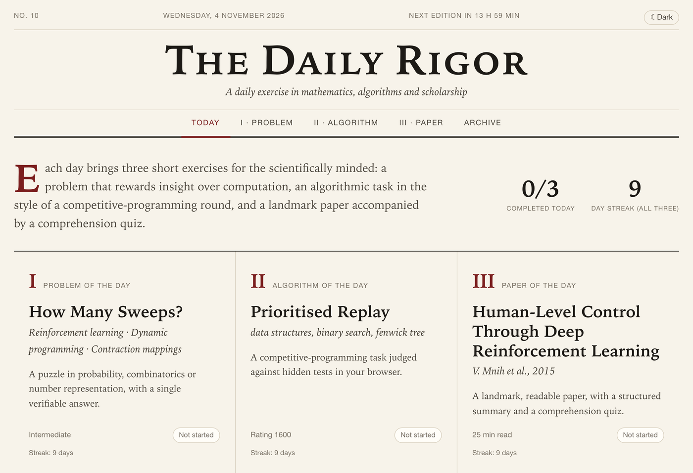
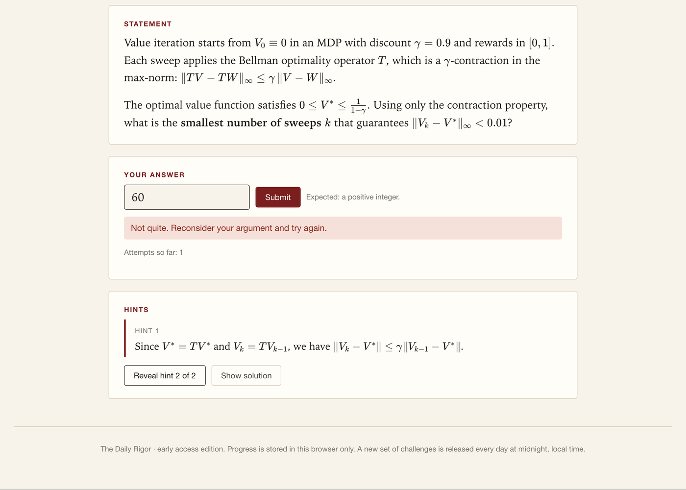
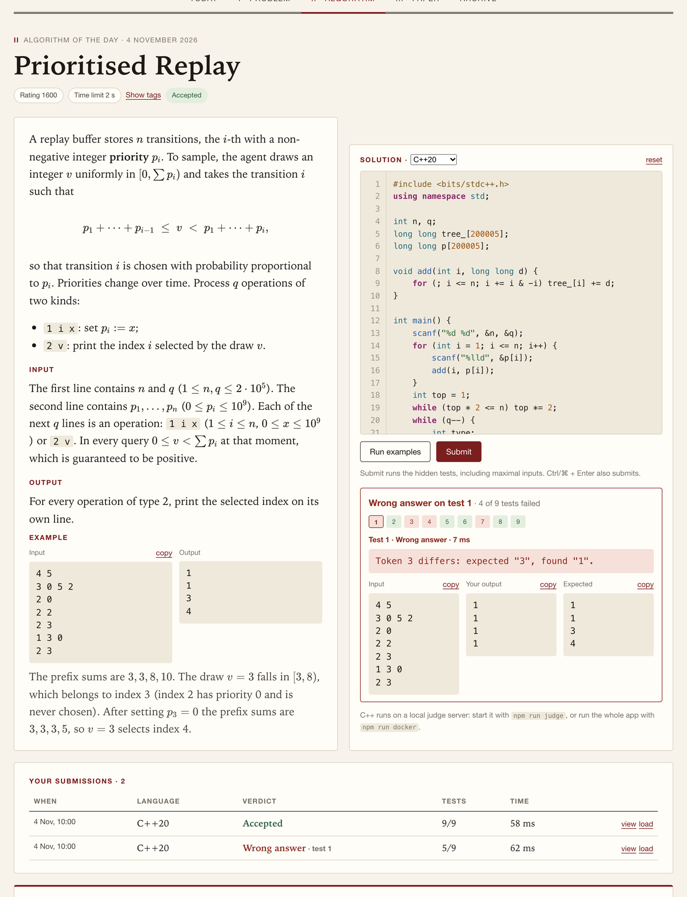
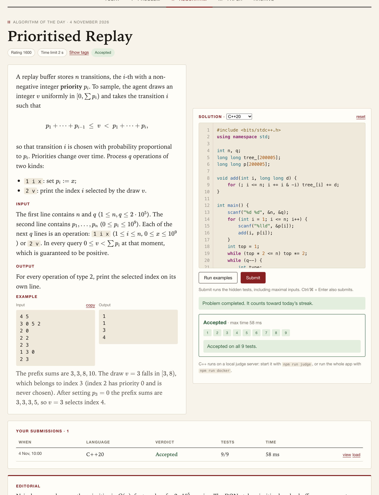
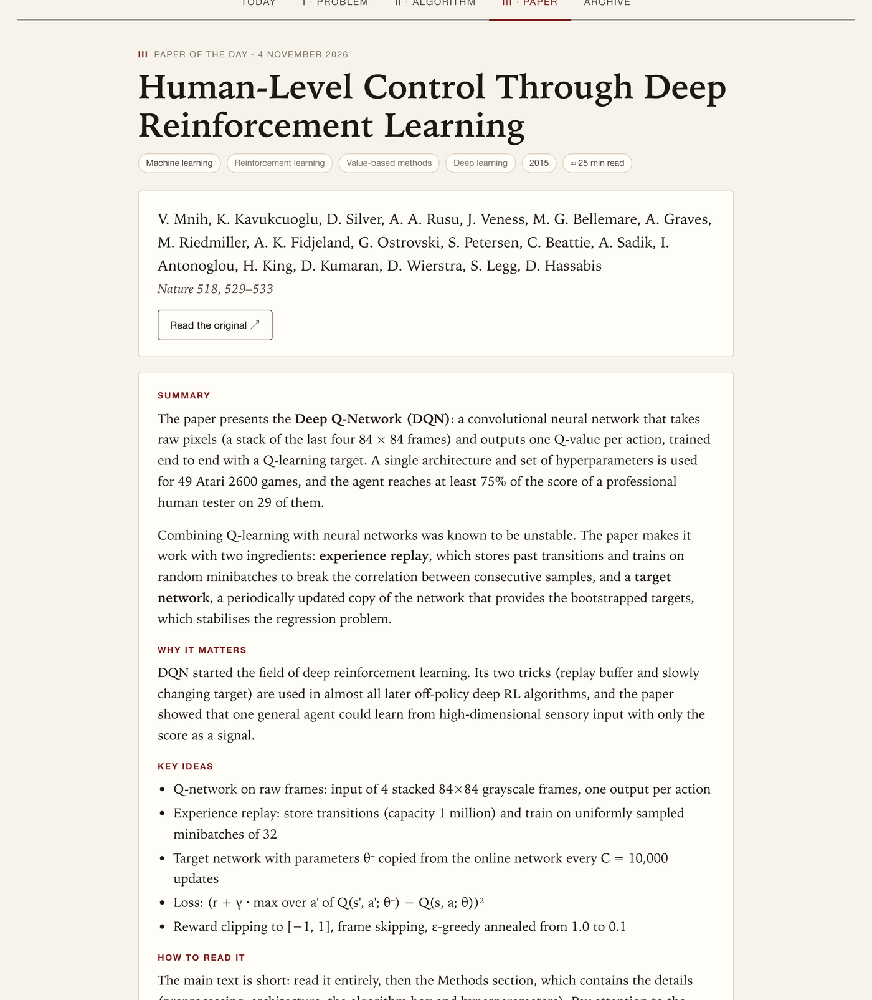
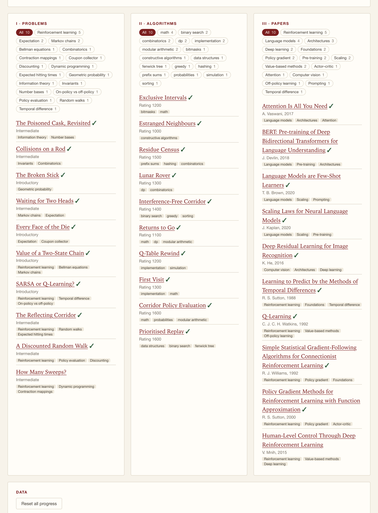
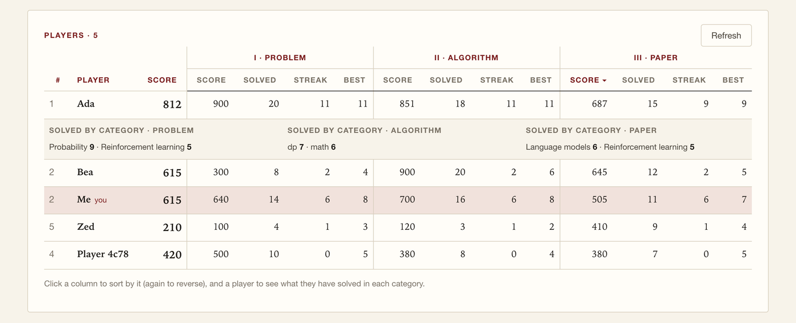
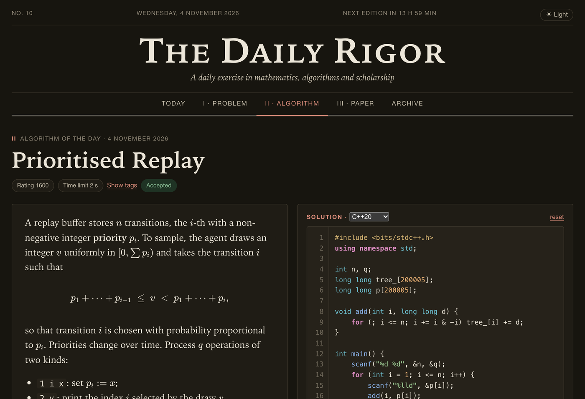

# The Daily Rigor

**A daily exercise in mathematics, algorithms and scholarship.**

### 🔗 Live site: **[the-daily-rigor.onrender.com](https://the-daily-rigor.onrender.com)**

*(It runs on a free host that sleeps when idle, so the first visit after a pause can take up to a minute to load.)*

Every day brings three short challenges for the scientifically minded: a puzzle that rewards insight over computation, a competitive-programming task judged against hidden tests (JavaScript or **C++20**), and a landmark paper with a comprehension quiz.




## Contents

- [The three challenges](#the-three-challenges)
- [Screenshots](#screenshots)
- [How it works](#how-it-works)
- [Project structure](#project-structure)
- [Quality checks](#quality-checks)
- [Security notes and known limits](#security-notes-and-known-limits)
- [Roadmap](#roadmap)

## The three challenges

| | What you get | How it is checked |
|---|---|---|
| **I · Problem** | A tricky puzzle (probability, combinatorics, number representation, and in the reinforcement-learning weeks Bellman equations and bandits) with one verifiable answer, progressive hints and a full solution | Numeric answer with tolerance; exact fractions such as `13/27` are accepted |
| **II · Algorithm** | A Codeforces-style task: statement, examples, input/output spec, hidden tests including maximal inputs, and an editorial | Run in a Web Worker (JavaScript) or on the C++ judge, with verdicts AC / WA / TLE / RE / CE |
| **III · Paper** | A landmark but readable paper (Transformers, scaling laws, RLHF, Q-learning, PPO, …) with summary, key ideas, a reading guide and a five-question quiz | Quiz with explanations; your first submission is recorded |

The library holds **36 items per section** (36 puzzles, 36 algorithm problems, 36 papers), enough for every day up to 30 November 2026 without a repeat, with category tags on every item. Papers lean towards machine learning and LLMs, but also include classics such as Turing's *Computing Machinery and Intelligence*, Diffie–Hellman, PageRank, Shannon's information theory and Lamport's logical clocks.

### Features

- **Streaks and progress** for each section and for "all three", stored in the browser (or in your account, see below).
- **A real code editor**: syntax highlighting for JavaScript and C++, line numbers, auto-indent, auto-closing brackets and quotes with skip-over, smart backspace, block expansion between braces, multi-line <kbd>Tab</kbd> / <kbd>Shift</kbd>+<kbd>Tab</kbd>, comment toggling with <kbd>Ctrl/⌘</kbd>+<kbd>/</kbd>, submit with <kbd>Ctrl/⌘</kbd>+<kbd>Enter</kbd>, and compiler errors highlighted on the offending line.
- **A judge report that helps you debug**: every test is run even after a failure, the failing tests are listed, and for each one you see the input, your output and the expected output (with copy buttons).
- **Submission history**: every submission, accepted or not, is saved with its code, language, verdict and time, and can be loaded back into the editor.
- **A scoreboard** of all signed-in players, sortable by every column: an overall score, solved counts, current and longest streaks for each of the three features, and what each player has solved per category.
- **Archive** of past editions with category filters. Only challenges that have already been released are listed, so tomorrow's problem stays hidden.
- **Light and dark themes** with a toggle (follows the system until you choose).
- **Sign-in with Google or GitHub** (no passwords) with progress synced to the cloud, or **guest mode** with progress saved in the browser. The C++ judge needs an account.
- **KaTeX maths** in every statement, solution and quiz.

## Screenshots

### Problem of the day
Hints are revealed one at a time, and wrong answers are counted.



### Algorithm of the day
C++ solutions are compiled and judged on the server. When a submission fails, the report shows which tests failed and what your program printed.

| Wrong answer | Accepted |
|---|---|
|  |  |

### Paper of the day



### Archive
Past editions, per-section streaks, and the full released library, browsable by category.



### Scoreboard
Every column can be sorted; clicking a player shows what they have solved in each category. (The players in this screenshot are sample data.)



### Dark theme

| Home | Algorithm |
|---|---|
|  |  |

## How it works

### The daily schedule
The days are numbered from **26 October 2026**. Day *d* shows the *d*-th item of each pool, so nothing repeats until a pool is exhausted. A themed week (the seven reinforcement-learning challenges of 31 October – 6 November) was slotted into the pools without deleting anything: the regular programme resumed exactly where it had left off, only shifted by seven days. The archive follows the same order, so future items are never exposed.

**The server decides what day it is.** The app asks the server for the time at start-up, then counts with the browser's monotonic timer, which does not move when the system clock is changed. The server also announces the time zone in which the day changes (Europe/Rome), so every visitor switches to the next edition at the same instant. If the server cannot be reached, the app falls back to the device's clock.

### The C++ judge
JavaScript solutions run in a Web Worker. C++ solutions are sent to a small dependency-free Node server that:

- compiles with `g++ -O2 -std=c++20`, with a **precompiled `<bits/stdc++.h>`** so a typical compile takes about a tenth of a second;
- runs the tests in batches over one request, each with a wall-clock limit, an output cap, and on Linux a memory limit and CPU-time limit;
- verifies the user's token with Supabase and applies per-user rate limits, at most 4 parallel jobs and a bounded waiting queue.

The whole site, the app and the judge, is **one Docker image** running in a hardened container: read-only filesystem, all Linux capabilities dropped, `no-new-privileges`, and memory, CPU and process limits.

### The scoreboard
Each feature is measured in its own unit: for **Problems**, the puzzles solved weighted by difficulty (Introductory 1, Intermediate 2, Advanced 4); for **Algorithms**, the sum of the Codeforces ratings of the problems solved; for **Papers**, the reading minutes of every paper completed multiplied by the quiz correctness. Each total is divided by the most it could ever be over the whole library and scaled to 1000, and the overall score is the mean of the three, so every feature weighs exactly a third whatever its natural unit. Streaks count daily challenges completed on their own day; a run that ended before yesterday shows as 0, and the longest run ever is kept alongside.

The scoreboard is computed **by the database**, from the progress each player has saved and a copy of the library (generated from the app's content), with the same formula as the app: that way it covers everybody who has ever signed in, even players who have not come back, and a test checks that the SQL and TypeScript versions agree on hundreds of random progress states. Everyone is listed automatically under a nickname of their choice (an anonymous "Player" with four hex digits until then), never with a name or email, and can hide from the board. It is read through a database function, since each player can only read their own row.

### Accounts and sync
Visitors sign in with Google or GitHub through Supabase, or **continue as a guest**:

| | Guest | Signed in |
|---|---|---|
| Problems, papers, archive, JavaScript judge | yes | yes |
| C++ judge | no | yes |
| Progress | this browser only (`localStorage`) | synced to the cloud, one row per user protected by row-level security |

Signing in starts from a clean slate: progress saved as a guest is discarded, never uploaded.

## Project structure

```
src/
  content/       math.ts · code.ts · papers.ts        all challenge content
                 rl-math.ts · rl-code.ts · rl-papers.ts   the reinforcement-learning week
                 schedule.ts                          slots a themed week into the pools
  lib/
    daily.ts     day numbering, daily rotation, "released" check for the archive
    clock.ts     server-decided time, immune to changes of the device clock
    progress.ts  progress store (localStorage), streaks, cross-tab sync
    submissions.ts  saved submissions with their code
    scoring.ts   the scoreboard formula (reference version of the SQL one), streaks, category counts
    judge.ts     Web Worker sandbox, C++ client, verdicts, custom checkers
    highlight.ts dependency-free tokenizer for JavaScript and C++
    auth.ts      Supabase sign-in (PKCE), guest mode
    cloud.ts     merge and sync of progress with the user's cloud row
    theme.ts     light/dark toggle
    answer.ts    numeric and fraction answer parsing with tolerance
    rng.ts       seeded PRNG for reproducible hidden tests
  pages/         Home · MathPage · CodePage · PaperPage · Archive · Scoreboard · Login
  components/    CodeEditor · Rich (light markup + KaTeX) · shared UI
server/          judge-server.mjs                     C++ compile/run + static hosting
supabase/        schema.sql · catalog.sql             tables, row-level security, scoreboard; library for the database
scripts/         verify-content.ts                    content verification
Dockerfile · docker-compose.yml
```

## Quality checks

A verification script (`scripts/verify-content.ts`) checks that:

- every reference solution reproduces the sample outputs, and agrees with an **independent brute-force implementation** on thousands of small random inputs;
- the hidden tests generate quickly, and every checker accepts its own reference;
- every puzzle answer is recomputed independently (exact enumeration or Monte Carlo);
- all quiz answers are in range, ids are unique across sections, and every piece of LaTeX renders;
- the copy of the library used by the database is up to date.

A second script runs the database schema on a real Postgres (in-process) and checks that the scoreboard computed there matches the TypeScript formula on 300 random progress states, that the access rules hold (nobody reads other players' rows, emails or ids), and that corrupt progress cannot take the board down.

## Security notes and known limits

- **Untrusted code runs on the judge host.** It needs a signed-in account, is rate-limited per user and runs in a locked-down container. Guests cannot use the C++ judge.
- **The date comes from the server, but only the date.** Changing the device clock no longer changes "today". It is still only a convenience, though: the whole content ships in the bundle, so someone with the developer tools can open any item directly, and nothing is secret anyway. The server does not record when you solved something, so completion dates are not provable.
- **Scoreboard numbers are not verified.** The database computes them, but from the progress each player has written, so they cannot exceed the maximum and need real item ids, yet a determined player could still invent a plausible progress. Treat the board as friendly rather than official.
- **Progress is not tamper-proof.** Guest data is in `localStorage` and cloud data is a row the user can write, so anyone can edit streaks and submissions (guest progress is at least never carried into an account). That is fine for personal motivation but rules out leaderboards. Making it trustworthy means recording completions on the server, with the server's date, and verifying answers there (puzzle and quiz answers in the database, code judged against tests held by the server).
- **Reference solutions, hidden tests and puzzle answers ship in the JavaScript bundle** (and are in this repository), so anyone can read them. That is fine for a self-study site, but they would have to move behind the server for a contest.
- The judge keeps compiled programs in memory between requests, so run **a single instance**.

## Roadmap

| Concern | Now | Next |
|---|---|---|
| Daily schedule | Deterministic rotation over fixed pools | Server-side schedule table (`date → item id`) |
| Judging | Hidden tests and references in the client | Server-side tests and sandboxing (for example Judge0 or isolate); more languages |
| Puzzle answers | Checked in the browser | Verified on the server |
| Content | TypeScript files | Database or CMS with an editorial workflow |
| Social | Private progress | Per-day leaderboards |
| Routing | Hash router | Shareable per-date URLs |
